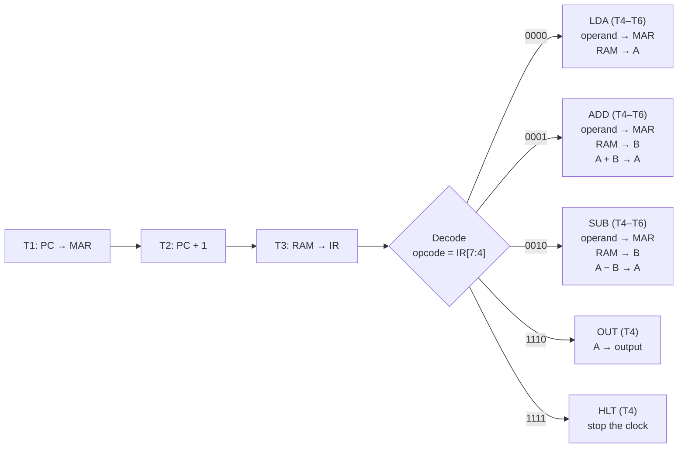

## What Is SAP-1?

SAP-1 ("Simple-As-Possible 1") is the first in the series of teaching computers described in Albert Paul Malvino's *Digital Computer Electronics*. It is deliberately tiny, with 16 bytes of memory, a handful of registers, one shared bus, and five instructions, yet it contains the core ideas of every real CPU: a program counter, a fetch-decode-execute cycle, an ALU, and a clocked control sequencer.

This simulator animates that machine so you can watch what happens on every single clock pulse.

| Property | SAP-1 |
|---|---|
| Data bus | One shared 8-bit bus, the **W-bus** (drawn here as the "radianite conduit") |
| Memory | 16 × 8-bit RAM (4-bit addresses `0H`–`FH`) |
| Instruction word | 8 bits: 4-bit opcode (upper nibble) + 4-bit operand address (lower nibble) |
| Registers | Program counter (PC), memory address register (MAR), instruction register (IR), accumulator (A), B register, output register |
| Arithmetic | 8-bit adder/subtractor; results wrap at `FFH` (modulo 256) |
| Timing | Six T-states per instruction: T1–T3 fetch, T4–T6 execute |
| Instruction set | `LDA`, `ADD`, `SUB`, `OUT`, `HLT` |

## Features

- **Pulse-by-pulse execution.** Run one whole instruction with **STEP**, advance a single timing pulse with **T-CYCLE**, or let **EXECUTE** auto-run the clock.
- **Visible data movement.** Cyan tokens travel along the "radianite conduit" (the shared W-bus) while registers light up as bus source, bus destination, or clocked register.
- **Live 16 × 8 RAM grid.** See every memory slot, with the program counter, the memory address register, and the active read highlighted.
- **Two ways to load a program.** Edit the 16-slot instruction sequence by hand, or use **Quick Loadout** to build an `X ± Y ± Z` formula from hex values `00`–`FF`.
- **Protocol Ledger.** Address, instruction, machine code, and execution status for every slot, following the program as it runs.
- **Output orbs and hex readout.** An 8-bit binary display (most significant bit first) plus the result in hex.
- **T-State Timing Generator.** Six timing nodes, T1–T3 (fetch) and T4–T6 (execute), light up as the clock advances.
- **Intel Briefing.** A running, step-by-step log that narrates what the machine is doing on each pulse.
- **Adjustable clock.** 100–1500 ms between pulses (700 ms by default), for slow-motion study or quick runs.
- **Built-in help and self-test.** *System Protocol* covers the architecture and instruction set and includes a **Run Diagnostics** self-test; *Agent Guide* is a five-step tutorial.
- **Optional sound effects.** Off by default.
- **Responsive and accessible.** Fluid layout from phones to ultrawide monitors, labelled controls, live regions, native dialogs, and reduced-motion support.
- **Zero JavaScript dependencies.** Plain HTML, CSS, and JavaScript: no framework, no bundler, no install step. Only the optional Google Fonts stylesheet is fetched from the network.


## How to Use

### 1. Load a program

The machine has 16 RAM slots, and a program is simply what you put in them. There are two ways to fill them:

- **Quick Loadout (fastest).** Open **Quick Loadout: Build a Formula**, enter hex values for **X**, **Y**, and **Z** (`00`–`FF`), choose `+` or `−` for each of the two operators, and press **BUILD**. The simulator assembles the matching program for you. The defaults compute `25 + 05 − 23`.
- **Manual editing.** Press **EDIT SEQUENCE**, change any of the 16 slots (one RAM slot per line), then press **LOAD INSTRUCTIONS**. Feedback appears directly under the editor.

### 2. Run it

| Control | What it does |
|---|---|
| **STEP** | Runs one whole instruction (all six T-states). |
| **T-CYCLE** | Advances exactly one T-state pulse, ideal for studying a single transfer. |
| **EXECUTE** | Auto-runs the clock until the program reaches `HLT`. |
| **Clock frequency** | Sets the delay between pulses, 100–1500 ms (default 700 ms). |
| **REBOOT** | Resets the PC and registers; your program stays loaded. |
| **Pause** (status bar) | Pauses and resumes the auto-run clock. |
| **Tactical SFX** | Toggles sound effects (off by default). |
| **System Protocol** | Opens the architecture and instruction-set reference, including **Run Diagnostics**. |
| **Agent Guide** | Opens the five-step tutorial. |

### 3. Read the result

When `HLT` executes, the clock stops. The result appears twice: in binary on the eight output orbs (most significant bit on the left) and in hex on the output terminal. Press **REBOOT** to run the same program again.

### Writing your own programs

- **16 slots, shared by code and data.** Every slot is one byte and can hold an instruction or a data value. The machine only knows the difference by what the program counter points at.
- **Execution starts at address `0H`** and runs straight through. SAP-1 has no jump or branch instructions.
- **Operands are addresses, not values.** `LDA 9H` loads the *contents* of slot `9H`, not the number 9.
- **End with `HLT` and keep your data after it** (for example in `9H`–`FH`). Otherwise the machine keeps fetching and executing whatever is in the next slot.
- **Arithmetic wraps** at 8 bits (see [Arithmetic behavior](#arithmetic-behavior)).

### Suggested exercises

1. **Trace it by hand.** Press **T-CYCLE** through the default program and write down what every register holds after each pulse. Then compare your notes with the **Intel Briefing**.
2. **Predict the wrap-around.** Build `05 + 00 − 23` and predict the orbs before you run it. (Answer: `E2H`, which is `1110 0010`.)
3. **Hand-assemble.** Use **EDIT SEQUENCE** to write a program for `10H + 20H + 30H − 05H` with four data slots. (Expected result: `5BH`.)

## Instruction Set and Machine Code

Every instruction is a single byte. The upper nibble is the opcode; the lower nibble is the operand, a RAM address.

```text
bit    7 6 5 4   3 2 1 0
       └─────┘   └─────┘
       opcode    operand
```

| Mnemonic | Opcode | Operand | Effect |
|---|---|---|---|
| `LDA addr` | `0000` | RAM address | `RAM[addr] → A` |
| `ADD addr` | `0001` | RAM address | `A + RAM[addr] → A` |
| `SUB addr` | `0010` | RAM address | `A − RAM[addr] → A` (B inverted, +1) |
| `OUT` | `1110` | unused | `A →` output terminal |
| `HLT` | `1111` | unused | Stop the clock |

### Worked example: `25H + 05H − 23H`

This is a hand-assembled version of the default Quick Loadout calculation. (The program **BUILD** generates is equivalent, but it may place its data in different slots.)

| Addr | Contents | Machine code | What happens |
|---|---|---|---|
| `0H` | `LDA 9H` | `09H` (`0000 1001`) | A ← `25H` |
| `1H` | `ADD AH` | `1AH` (`0001 1010`) | A ← `25H + 05H` = `2AH` |
| `2H` | `SUB BH` | `2BH` (`0010 1011`) | A ← `2AH − 23H` = `07H` |
| `3H` | `OUT` | `EFH` (`1110 0000`) | Output ← `07H` |
| `4H` | `HLT` | `FFH` (`1111 0000`) | Clock stops |
| `5H`–`8H` | unused | — | — |
| `9H` | data | `25H` | X |
| `AH` | data | `05H` | Y |
| `BH` | data | `23H` | Z |
| `CH`–`FH` | unused | — | — |

The operand nibble of `OUT` and `HLT` is ignored; it is shown as `0` here. Final result: orbs `0000 0111`, terminal `07H`.

### Arithmetic behavior

- The adder/subtractor is 8 bits wide, so results wrap modulo 256: `FFH + 01H = 00H` and `00H − 01H = FFH`.
- `SUB` works by inverting B and adding 1 (two's complement), so `05H − 23H = E2H`, which reads as −30 when interpreted as a signed byte.

## How One Instruction Executes

Every instruction takes exactly six timing pulses (T-states). During **T1–T3 (fetch)** the control sequencer copies the next instruction from RAM into the instruction register. During **T4–T6 (execute)** it does whatever the opcode requires, using the lower nibble of the IR as the operand address. The shared 8-bit bus carries a single transfer per pulse.



**Fetch (every instruction)**

| T-state | Operation |
|---|---|
| T1 | `PC → MAR`: the address of the next instruction goes to the memory address register |
| T2 | `PC + 1 → PC`: the program counter advances |
| T3 | `RAM[MAR] → IR`: the instruction byte is loaded into the instruction register |

**Execute**

| Instruction | T4 | T5 | T6 |
|---|---|---|---|
| `LDA` | `IR[3:0] → MAR` | `RAM[MAR] → A` | idle |
| `ADD` | `IR[3:0] → MAR` | `RAM[MAR] → B` | `A + B → A` |
| `SUB` | `IR[3:0] → MAR` | `RAM[MAR] → B` | `A − B → A` |
| `OUT` | `A → output` | idle | idle |
| `HLT` | stop the clock | — | — |

This is the standard SAP-1 sequence, and the **Intel Briefing** panel narrates it as it happens. For example, here is `LDA 9H` fetched from address `0H` in the worked example above:

| T-state | Operation | Value |
|---|---|---|
| T1 | `PC → MAR` | `0H` |
| T2 | `PC + 1 → PC` | PC becomes `1H` |
| T3 | `RAM[0H] → IR` | `09H` |
| T4 | `IR[3:0] → MAR` | `9H` |
| T5 | `RAM[9H] → A` | `25H` |
| T6 | idle | — |

## Interface Tour

| Panel | What it shows |
|---|---|
| **Header** | Title, a live `FETCH // DECODE // EXECUTE` phase indicator, and buttons for *System Protocol* and *Agent Guide*. |
| **Instruction Sequence (Assembly RAM)** | The 16-slot program editor with **EDIT SEQUENCE** and **LOAD INSTRUCTIONS**, plus the *Quick Loadout* formula builder. |
| **Radianite Core Storage (16 × 8 RAM)** | The memory grid, two rows of register cards, the conduit (W-bus), the 8-bit output orbs, and a result caption. |
| **Protocol Ledger (RAM and Machine Code)** | A table of address, instruction, machine code, and status. The executing row is highlighted. |
| **Protocol Override Controls** | **STEP**, **T-CYCLE**, **EXECUTE**, **REBOOT**, the clock-frequency slider, and the sound-effects toggle. |
| **T-State Timing Generator** | Nodes T1–T6, grouped into the fetch and execute phases. |
| **Intel Briefing (Step-by-Step Logic)** | A live log narrating the machine's logic, step by step. |
| **Status bar** | The current operation (`STANDBY` when idle), three live status readouts, and a pause toggle. Pinned to the bottom of the window. |

**Color legend**

| Color | Meaning |
|---|---|
| Cyan | Data in motion: the lit conduit and its travelling token, a register acting as bus source or destination, and the RAM cell addressed by the MAR |
| Red | Clock activity: a register being clocked, the current T-state, the executing ledger row, the RAM cell being read, and lit output orbs |
| Gold | The program counter's address label in the RAM grid and the executing row's status text |

## Project Structure

```text
sap1-simulator/
├── index.html    # Markup: header, six panels, status bar, and the two help dialogs
├── style.css     # Tactical HUD theme and fluid, responsive layout
├── cpu.js        # SAP-1 machine model: memory, registers, instruction sequencing
├── ui.js         # Interface logic: rendering, controls, bus animation, dialogs
├── LICENSE
└── README.md
```

- The scripts are classic (non-module) `<script>` tags, loaded in the order `cpu.js` then `ui.js`.
- The scripts hook into the markup through element IDs (for example `#ed`, `#ld`, `#st`, `#sc`, `#run`, `#rs`, `#hz`) and `data-dlg` attributes, so keep those stable when restyling.
- Built with HTML5, CSS3 (custom properties, Grid, `clip-path`, `backdrop-filter`), and vanilla JavaScript. Typefaces: Oswald and Roboto Mono via Google Fonts.

## Customization

### Theme tokens

All colors, the corner-cut size, and the font stacks are CSS custom properties at the top of `style.css`:

| Variable | Default | Controls |
|---|---|---|
| `--bg` | `#0f1923` | Page background (dark slate) |
| `--pn` | `rgba(22,35,48,.78)` | Panel fill (frosted glass) |
| `--ln` | `rgba(255,255,255,.13)` | Hairlines and borders |
| `--ink` | `#ece8e1` | Primary text |
| `--mu` | `#93a1ae` | Muted text and labels |
| `--red` | `#ff4655` | Primary accent: clock activity, key buttons, highlights |
| `--cy` | `#00f0ff` | Secondary accent: bus activity and the focus ring |
| `--gold` | `#ffd24a` | PC marker and executing status |
| `--cut` | `12px` | Size of the notched panel corners |
| `--hd` | `"Oswald", …` | Heading font stack |
| `--mn` | `"Roboto Mono", …` | Monospace font stack |

For example, an amber terminal look:

```css
:root {
  --bg:   #0b0f0a;
  --red:  #ff9f1c;  /* primary accent */
  --cy:   #7dff6b;  /* secondary accent */
  --gold: #ffe066;  /* highlights */
}
```

> The UI is intentionally dark-only (`color-scheme: dark`). A few translucent glows are hard-coded as `rgba()` values derived from the default colors, so for a complete re-theme also search `style.css` for `0,240,255` (cyan) and `255,70,85` (red).

### Layout and defaults

- On screens 1101 px and wider, the `.up` and `.lo` wrappers use `display: contents`, so all six panels sit in one CSS grid defined on `main`. The final block of `style.css` ("Fluid full-viewport layout") controls the desktop and ultrawide arrangements.
- The Quick Loadout defaults are the `value` attributes on `#x`, `#y`, and `#z`, and the `selected` operators on `#o1` and `#o2`, in `index.html`.
- To change fonts, replace the Google Fonts `<link>` in `index.html` and update `--hd` and `--mn`. For fully offline use, self-host the font files and add matching `@font-face` rules.

## Responsive Layout

| Viewport | Layout |
|---|---|
| 1101 px and wider | Two rows of three panels that stretch to fill the window; the root font size scales between 16 px and 22 px with the viewport |
| 1101 px and wider, aspect ratio ≥ 19:10 | Four columns for ultrawide monitors, with controls, timing, and the Intel Briefing stacked on the right (root font up to 26 px) |
| 701–1100 px | Two columns, with the core-storage panel full-width on top |
| 700 px and narrower | Single column, with a smaller title and compact output orbs |

Safe-area insets are respected on notched phones, and the status bar stays pinned to the bottom of the screen.

## Accessibility

- **Landmarks and headings:** `<header>`, `<main>`, and `<footer>`, with each panel a `<section>` labelled by its heading.
- **Keyboard:** every control is a native button, input, or select, so Tab, Enter, and Space work out of the box, with a visible `:focus-visible` ring.
- **Live regions:** status messages, the result caption, and the Intel Briefing feed use `aria-live="polite"`.
- **Text alternatives:** the output orbs expose a label that states the bit order (most significant bit first), and toggle buttons expose their state with `aria-pressed`.
- **Dialogs:** the help screens use native `<dialog>` elements.
- **Reduced motion:** the conduit pulse animation is disabled under `prefers-reduced-motion: reduce`.
- **Readable text:** the root font size is clamped so text never drops below 16 px.

## Browser Support

Any current evergreen browser (Chrome, Edge, Firefox, Safari, including mobile). The interface relies on `<dialog>`, `backdrop-filter`, `clip-path`, `clamp()`/`min()`, and `:focus-visible`, so browsers from roughly mid-2022 onward are expected to work well. Internet Explorer is not supported.
